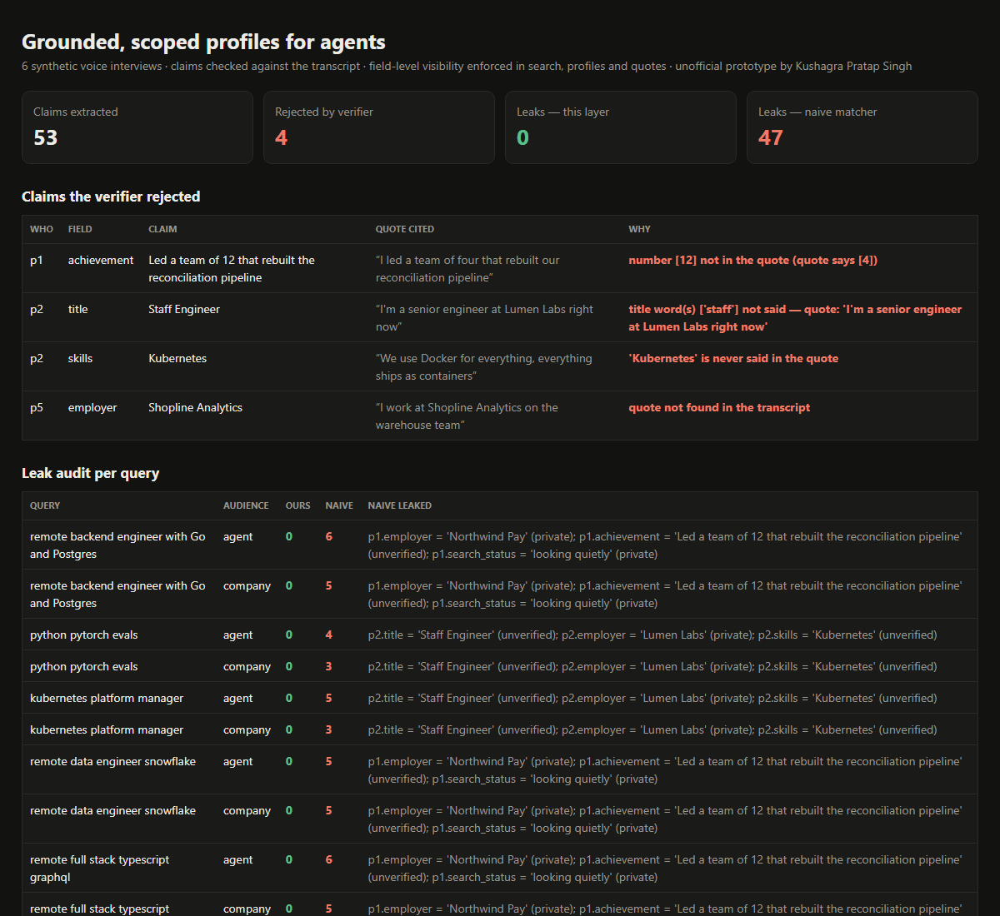

# Grounded, Scoped Profiles for Agents

> Unofficial prototype by Kushagra Pratap Singh. Not affiliated with Pluto.

## The problem

Pluto turns a 10-minute voice conversation into a structured career profile. The person reviews it and "choose[s] what to share", and then "people and AI agents" can discover them. The goal is to let "AI agents understand and act on professional profiles while keeping individuals in control of their information" ([launch post](https://www.ycombinator.com/launches/RTP-pluto-ai-voice-agent-that-helps-professionals-get-discovered), [talentpluto.com](https://talentpluto.com)).

Once agents are the ones reading profiles, two things have to hold:

1. **Every claim is something the person actually said.** A profile written by an AI from a voice call can drift: "team of four" becomes "led a team of 12", "senior" becomes "Staff", a skill gets added that was never mentioned, or a quote gets invented.
2. **"Private by default" survives every output.** That includes search results, profile reads, match explanations, and the evidence quotes themselves. "I'm a senior engineer at Northwind Pay" is fine for the title, but it reveals an employer the person kept private.

## What I built

A small stdlib Python layer between profiles and agents.



```
53 claims extracted from 6 voice interviews -> 4 rejected by the verifier
  ✗ p1 achievement 'Led a team of 12 …'   — number [12] not in the quote (quote says [4])
  ✗ p2 title       'Staff Engineer'      — title word(s) ['staff'] not said
  ✗ p2 skills      'Kubernetes'          — 'Kubernetes' is never said in the quote
  ✗ p5 employer    'Shopline Analytics'  — quote not found in the transcript

Leak audit (private or unverified values in responses):
  ours:  0 leaks across 12 searches + 12 profile reads
  naive: 47 leaks across the same 12 searches
```

| Piece | What it does |
|---|---|
| **Grounding verifier** | Every extracted claim must carry a quote + timestamp. The quote must exist in the transcript (exact or ≥ 0.9 fuzzy), every number in the claim must be in the quote ("four" = 4), and skills, title words and employer names must actually be said. Unsupported claims are never served |
| **Visibility policy** | Per field, per person: `private` < `companies` (verified hiring teams) < `agents` (any AI agent). The defaults mirror "private by default", e.g. employer, salary and "looking quietly" stay private |
| **Quote redaction** | Evidence quotes are verbatim speech, so any value the person kept hidden is replaced with `[hidden]` before serving |
| **Search + profile** | Matching uses only verified claims the requester is allowed to see, and every reason comes with a quote and timestamp |
| **Agent surface** | An MCP-style tool schema (`search_professionals`) and a stdlib HTTP endpoint: `/tool`, `/search?q=…&audience=agent`, `/profile/p1?audience=company` |
| **Naive baseline** | The same matcher without the guards, to make the leak audit concrete |

**About the data:** the six interviews are made up. The claim file stands in for an extraction model's output, and I planted the four wrong claims in it on purpose. The leak audit counts private or unverified values that appear in each person's part of a response. Tests cover every query × audience, every profile read, quote redaction and the HTTP endpoint. A real version would put a live extractor (e.g. a JSON-schema LLM call that must return quote + timestamp) in front of the same verifier.

## Run it (3 commands)

```bash
pip install -r requirements.txt    # only pytest; the layer is stdlib
python demo.py                     # verifier + leak audit, writes out/report.html  (add --serve for :8765)
python -m pytest -q                # 10 tests
```

---
Unofficial prototype by Kushagra Pratap Singh. Not affiliated with Pluto.
